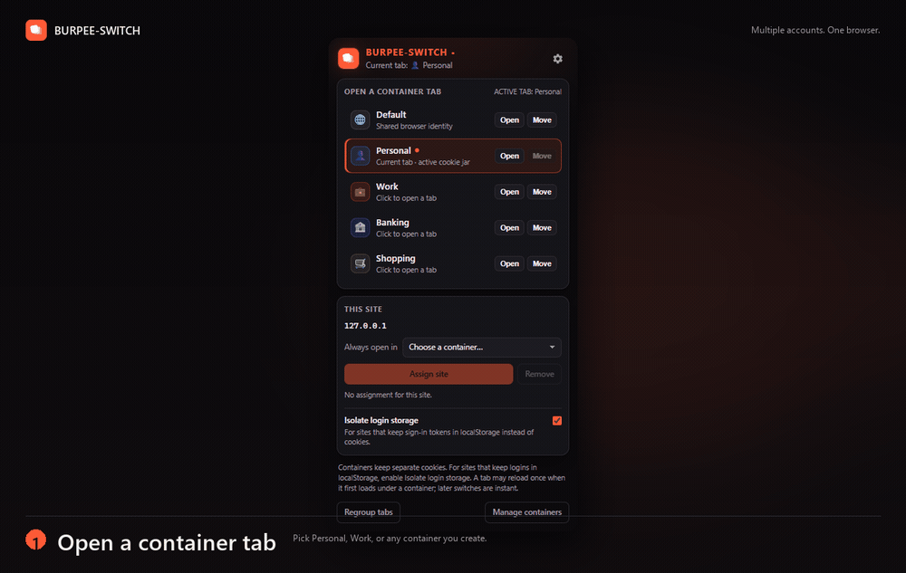

# BURPEE-SWITCH

**Multiple accounts. One browser.**

BURPEE-SWITCH is a container-style extension for Chrome, Brave, Edge, and other Chromium browsers.
Keep work, personal, and client accounts open in the same window — each tab has its own container,
cookies, color, and label.



## Features

- **Multiple accounts in one window** — keep work, personal, and client logins open side by side.
- **Simple container tabs** — open a tab in Default, Personal, Work, or any container you create.
- **Separate cookies** — each container gets its own saved session, restored when you switch tabs.
- **Optional login-storage isolation** — also separate `localStorage` for sites that keep sign-in
  tokens outside cookies.
- **Instant switching** — after a tab has loaded, switching to it does not reload the page.
- **Restore after restart** — tabs reopen in the containers you assigned.
- **Site rules** — send a domain to a specific container automatically.
- **Clear visual labels** — colored dots, titles, tab groups, or a page edge show which account a
  tab belongs to.
- **Burp Suite support** — optional request headers and a highlighter JAR make traffic easy to
  identify.
- **Stays local** — no accounts, cloud, analytics, or telemetry.

## Install

1. Download or clone this repository.
2. Open `chrome://extensions` (or `brave://extensions`, `edge://extensions`).
3. Enable **Developer mode**.
4. Click **Load unpacked** and select the `BURPEE-SWITCH` folder.
5. Pin BURPEE-SWITCH to the toolbar.

Requires Chrome 119 or newer.

## Usage

1. **Open the popup.** Click the BURPEE-SWITCH icon in the toolbar.
2. **Choose a container.** Click **Open** next to Personal, Work, or any container. A new tab opens
   in that container.
3. **Sign in.** Log in to the site once in each container.
4. **Switch tabs.** Each tab keeps its own account. Use **Move** to move the current tab to another
   container.
5. **Optional: isolate login storage.** For sites that keep sign-in tokens in `localStorage`, enable
   **Isolate login storage** under **This site**, then sign in once per container.
6. **Optional: create a site rule.** Under **This site**, choose **Always open in** to send that
   domain to a container automatically.

**Tip:** Right-click any link or page and choose **Open link/page in container**. Use **Manage
containers** in the popup for names, colors, icons, site rules, and tab indicators.

## Good to know

- One container is active at a time. Keep one tab per site per container to avoid overlapping
  background requests.
- A tab may reload once when it first loads under a container. Switching between already-loaded tabs
  is instant.
- This is a convenience layer, not a security boundary. For strict isolation, use separate browser
  profiles.
- Incognito windows are not supported.
- `localStorage` is isolated only for sites where you enable **Isolate login storage**.
  `sessionStorage`, IndexedDB, and in-memory state stay shared.

## Burp Suite

Enable **Burp Suite headers** in the options page to add `X-Container-Name`, `X-Container-Color`, and
`X-Container-Tab` to proxied requests. To color Burp's proxy history automatically, download and load
the [highlighter JAR](https://github.com/alielbadry/burpee-switch/releases/latest/download/containers-burp-highlighter.jar)
as a Java extension in Burp.

The headers are visible to the destination site, so enable them only while testing.

## Development

No build step. Edit the source and click **Reload** on `chrome://extensions`.

```powershell
npm run check     # manifest, JavaScript syntax, icon dimensions, HTML references
npm run icons     # regenerate icons from icons/burpee-switch-master.png
```

If PowerShell blocks `npm.ps1`, use `npm.cmd run check`.

## License

[MIT](LICENSE)
